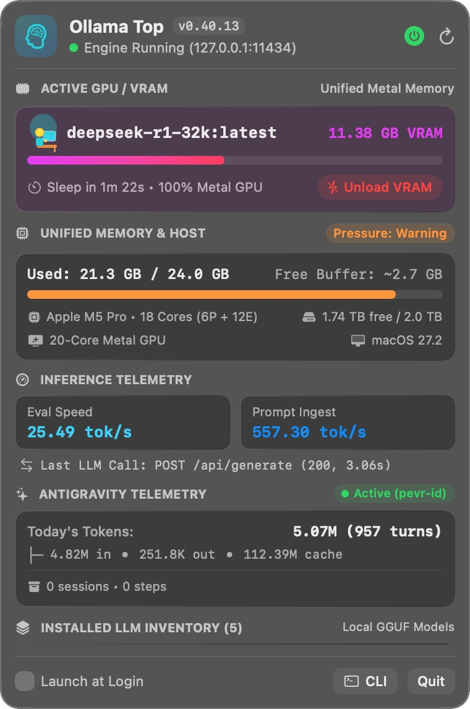

# 🧠 OllamaTop (`ollama-top`)

[](https://github.com/squallbayu/ollama-top/actions/workflows/ci.yml)
[](https://github.com/squallbayu/ollama-top/releases)
[](https://www.gnu.org/licenses/gpl-3.0)
[](https://github.com/squallbayu/ollama-top)

**Native macOS Menu Bar Widget (`OllamaTop.app`) & Zero-Dependency Terminal TUI (`ollama-top`) for Real-Time [Ollama](https://ollama.com) VRAM, Unified Memory, and Token Speed Monitoring.**

Built specifically for **Apple Silicon (M1 / M2 / M3 / M4 / M5)** Unified Memory workflows—operating **100% in user space (`sudo`-free)** with **`0.0%` background CPU overhead**.

<p align="center">
  <a href="docs/assets/ollama-top-menubar.jpg">
    
  </a>
</p>
<p align="center">
  <em><b>OllamaTop in action on Apple M5 Pro:</b> Live menu bar pill (<code>Qwen 8.5G</code>), active Metal GPU residency (<code>qwen2.5-coder:14b</code> at <code>8.48 GB VRAM</code> with one-click <code>Unload VRAM</code>), Unified Memory pressure tracking (<code>20.8 / 24.0 GB</code>), real-time inference speeds (<code>27.89 tok/s</code> eval &amp; <code>679.91 tok/s</code> prompt ingest), and instant GGUF model switching.</em>
</p>

---

## ✨ Key Features

- **🟢 Always-Visible Menu Bar Pill**: See at a single glance whether GPU Unified Memory is clean (`🧠 Idle`) or holding a resident LLM (`🧠 Qwen 8.5G`, `🧠 R1 8.5G`, `⚡ Off`) without leaving your IDE.
- **⚡ One-Click & One-Key VRAM Eviction**: Reclaim 8–20+ GB of Unified Memory immediately (`Unload VRAM` button in Menu Bar or `[u]` in CLI) instead of waiting 5 minutes for Ollama's default `keep_alive` timeout.
- **🔥 Warm Preload & Model Switching**: View your entire on-disk GGUF catalog (`/api/tags`) with estimated KV-cache VRAM footprints and preload any model into Metal GPU memory in one click.
- **🍏 Native Darwin Mach Kernel Telemetry (`0.0%` CPU)**: Reads active, wired, and compressed Unified Memory pages and kernel VM pressure (`Normal` / `Warning` / `Critical`) directly in-process via `host_statistics64` and `sysctlbyname`—spawning zero background shell processes.
- **🖥️ Multi-Monitor Control Center Dropdown**: Frosted glass `NSVisualEffectView` panel pinned strictly below the menu bar across MacBook Notch Retina displays and external 1080p/4K monitors.
- **📊 Live Token Speed Telemetry**: Automatically discovers your Ollama server log (`~/.ollama/logs/server.log`, Homebrew, or custom `$OLLAMA_LOG_PATH`) to display real-time generation speed (`tok/s`), prompt ingestion speed (`tok/s`), and last API latency.
- **🚀 Antigravity Agent Telemetry**: Seamlessly reads local runtime transcripts (`~/.gemini/antigravity-cli/`) with zero cloud dependencies to display today's token usage (input, output, and prompt cache hit rates), active workspace, and lifetime agent steps.
- **🔌 Multi-Installation Service Control**: Start or stop Ollama directly from the Menu Bar whether installed via official `Ollama.app`, Homebrew (`brew services`), or a custom user `LaunchAgent`.

---

## 🚀 Quick Install (Zero `sudo` Required)

### Option 1: One-Line Public Installer (Prebuilt Universal Binary + Source Fallback)

```bash
curl -fsSL https://raw.githubusercontent.com/squallbayu/ollama-top/main/scripts/install.sh | zsh
```

This installs:
- **Menu Bar App**: `~/Applications/OllamaTop.app` (launched automatically in your top menu bar)
- **Terminal TUI**: `~/.local/bin/ollama-top`
- **Menu Bar Helper**: `~/.local/bin/ollama-bar` (`start | stop | restart | status`)

### Option 2: Build Natively from Source (Public Builder)

Requires macOS 13.0+ and Xcode Command Line Tools (`xcode-select --install`):

```bash
git clone https://github.com/squallbayu/ollama-top.git
cd ollama-top

# Build & install into ~/Applications and ~/.local/bin:
make install

# Or build distributable Universal (arm64 + x86_64) release archives in ./dist/:
make package
```

---

## 🖥️ Usage

### 1. macOS Menu Bar Widget (`OllamaTop.app`)

Once running, look at the right side of your macOS Menu Bar:
- **Click the Menu Bar Pill** to open the frosted Control Center dashboard.
- Click **`Unload VRAM`** to evict the active model (`keep_alive: 0`) and return GPU VRAM to `0.00 GB`.
- Click **`Load`** next to any standby model to stream it from NVMe SSD into Metal GPU RAM.
- Toggle **`Launch at Login`** in the bottom-left footer to start automatically when you sign into macOS.
- Manage from terminal anytime with `ollama-bar start | stop | restart | status`.

### 2. Terminal TUI Dashboard (`ollama-top`)

Ideal for terminal pair-programming, `tmux` panes, or remote SSH sessions into a Mac Studio / Mac mini:

```bash
# Interactive live dashboard (refreshes every 1.5s):
ollama-top

# Custom refresh interval (e.g. 1.0s):
ollama-top -i 1.0

# Single snapshot to stdout and exit:
ollama-top --once
```

**Interactive TUI Hotkeys:**
- `u` — Immediately flush active models from VRAM (`0 GB`)
- `r` — Refresh metrics immediately
- `q` / `Ctrl-C` — Quit cleanly

```text
=== OLLAMA SYSTEM & LLM MONITOR (ollama-top) ===
Engine: ● RUNNING (v0.40.13)  |  Host: http://127.0.0.1:11434
──────────────────────────────────────────────────────────────────────────
HOST HARDWARE SPECS (APPLE SILICON)
  Chip & CPU:   Apple M5 Pro  |  18 CPU Cores
  Graphics:     20-Core Metal GPU  |  OS: macOS
  Storage NVMe: 1.60 TB free (2.0 TB total)
──────────────────────────────────────────────────────────────────────────
UNIFIED MEMORY (RAM / VRAM SHARED)
  Unified RAM:  [██████████████░░░░░░] 72% 17.3 GB / 24.0 GB
  RAM Pressure: Normal  |  Free Memory Buffer: ~6.7 GB
──────────────────────────────────────────────────────────────────────────
ACTIVE MODEL IN VRAM
  ▶ ACTIVE: qwen2.5-coder:14b
    VRAM Usage:  [██████░░░░░░░░░░] 35% 8.48 GB (100% GPU Metal Shaders)
    Auto-Sleep:  Auto-sleep in 4m 32s (Drops to 0 GB VRAM when idle)
──────────────────────────────────────────────────────────────────────────
ANTIGRAVITY USAGE & RUNTIME TELEMETRY
  Agent Process:           ● ACTIVE (PID 15204, pevr-id)
  Today's Tokens:          2.77M tokens (466 turns)
    └─ Breakdown:          2.48M in • 293.1K out • 61.45M cache
  Lifetime Stats:          9 sessions • 26.8K steps (13,059 turns)
  Last Session:            Ollama and Antygravity Integration
──────────────────────────────────────────────────────────────────────────
Keys: [u] Unload VRAM immediately  |  [r] Refresh  |  [q] Quit
```

---

## ⚙️ Configuration (Environment Variables)

Both `OllamaTop.app` and `ollama-top` work out of the box with zero configuration, and optionally respect:

| Variable | Default | Description |
| :--- | :--- | :--- |
| `OLLAMA_HOST` | `http://127.0.0.1:11434` | Target Ollama HTTP API host and port. |
| `OLLAMA_LOG_PATH` | *Auto-discovered* | Explicit path to Ollama server log for `tok/s` speed parsing (auto-detects `~/.ollama/logs/server.log`, `~/.gemini/ollama_daemon.log`, and Homebrew logs). |

---

## 📚 Spec-Driven Development Design Docs (`01` – `06`)

Architectural specifications and engineering invariants are maintained in [`docs/`](docs/):

1. [**01 — Product Requirements Document (PRD)**](docs/01_PRODUCT_REQUIREMENTS.md): Vision, user personas, feature matrix, and explicit non-goals.
2. [**02 — Technical Requirements & Architecture (TRD)**](docs/02_TECHNICAL_REQUIREMENTS.md): Canonical stack, Darwin Mach `host_statistics64` telemetry, and multi-monitor Cocoa coordinate invariants.
3. [**03 — App Flow & User Journeys**](docs/03_APP_FLOW.md): Menu bar state machine, dropdown sequence diagrams, and TUI event loop.
4. [**04 — UI/UX Design Brief**](docs/04_DESIGN_BRIEF.md): Control Center vibrancy materials, semantic color tokens, and monospaced typography system.
5. [**05 — Telemetry, API & Kernel Schema**](docs/05_BACKEND_SCHEMA.md): Ollama REST JSON contracts, Mach VM structs, LaunchAgent plists, and log regex specifications.
6. [**06 — Implementation Plan & Public Builder**](docs/06_IMPLEMENTATION_PLAN.md): 6-phase build order, Universal Binary `lipo` pipeline, CI/CD release automation, and verification checklist.

---

## 📄 License

Licensed under the **GNU General Public License v3.0 (GPL-3.0)** — see [LICENSE](LICENSE) for full details.
