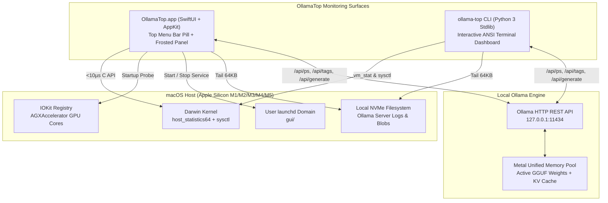

# 2. Technical Requirements & Architecture (TRD)

> **Spec-Driven Development Doc #2 — Technical Requirements & System Architecture**
> Consolidates the canonical tech stack, Darwin kernel interfaces, multi-monitor Cocoa coordinate invariants, and zero-dependency constraints.

---

## 🛠️ 1. Canonical Tech Stack Matrix

| Layer | Technology | Version / Target | Purpose & Architectural Constraint |
| :--- | :--- | :--- | :--- |
| **Menu Bar UI** | SwiftUI + AppKit | Swift `5.9+` / `6.x` (`-swift-version 5`) | Native `NSStatusItem` + custom `MenuBarPanel` (`NSPanel`) + `NSVisualEffectView`. |
| **Minimum OS** | macOS Ventura+ | `macOS 13.0+` (`arm64` & `x86_64`) | Universal binary compiled via `-target arm64-apple-macos13.0` & `x86_64-apple-macos13.0`. |
| **Kernel Memory API** | Darwin Mach C API | `host_statistics64` (`HOST_VM_INFO64`) | Direct in-process Unified Memory & compressor page reads in `<10 µs` (`0.0%` CPU). |
| **Hardware Discovery** | `sysctlbyname` + IOKit | `ioreg -rc AGXAccelerator -d 1` | Dynamic Apple Silicon SoC name, P/E CPU core split, Metal GPU core count, VM pressure. |
| **Terminal TUI** | Python 3 Standard Library | Python `3.9+` (`#!/usr/bin/env python3`) | **Strictly zero `pip` dependencies** (`urllib.request`, `termios`, `tty`, `select`). |
| **Icon Pipeline** | CoreGraphics + `iconutil` | `menubar/make_icon.swift` | Generates 10 Retina PNG resolutions (`16px`–`1024px`) into `AppIcon.icns` at build time. |
| **Build & CI/CD** | Zsh + GNU Make + GitHub Actions | `macos-latest` runner | Produces `OllamaTop.app` Universal `.zip`, CLI `.tar.gz`, and `SHA256SUMS.txt`. |
| **License** | GNU GPL v3.0 | `SPDX: GPL-3.0-or-later` | Free and open-source copyleft software. |

---

## 🏛️ 2. High-Level System Architecture

---

## 📐 3. Critical Engineering Invariants

### 3.1 Tiered Polling & `0.0%` Background CPU Budget
When `OllamaTop.app` is sitting closed in the macOS Menu Bar:
- **Lightweight Loop (`2.5s` interval)**: Executes in-process `host_statistics64` (zero child processes) + two tiny localhost HTTP GETs (`/api/version` and `/api/ps`). Measured steady-state CPU usage on Apple Silicon is **`0.0%`**.
- **On-Demand Heavy Loop (`isPopoverVisible == true`)**: Only while the user has the dropdown panel open does `OllamaTop.app` run the `1.0s` countdown ticker, query `/api/tags` for installed disk models, refresh filesystem free space, and parse the last `64 KB` of the server log on a background `.utility` detached task.

### 3.2 Multi-Monitor Top-Pinned Cocoa Coordinate Lock
In macOS AppKit, screen coordinates originate at the **bottom-left `(0, 0)`**, meaning increasing a window's `frame.size.height` while keeping `frame.origin.y` fixed expands the window **upward** through the Menu Bar. Furthermore, `NSStatusBarButton` uses `isFlipped == true` and spans multiple `NSStatusBarWindow` instances across external displays.

To guarantee the popup **never** renders above or over the Menu Bar on any display (Notch Retina or external 1080p/4K monitors):
1. Detect the active click target via `NSEvent.mouseLocation` intersected against `NSScreen.screens` and `NSApp.currentEvent?.window`.
2. Compute `lockedTopY = min(menuBarBottomY, screen.frame.maxY - 25.0) - 6.0`.
3. Subclass `NSHostingView` (`PinnedTopHostingView`) to intercept `invalidateIntrinsicContentSize()` and recompute `originY = lockedTopY - fittingHeight`, ensuring all dynamic SwiftUI height changes expand **strictly downward**.

### 3.3 Unified Memory Calculation Parity
Both the Swift Menu Bar app and Python CLI compute Unified Memory usage identically to macOS Activity Monitor's App + Wired + Compressed memory model:

$$\text{Used Bytes} = (\text{Pages}_{\text{active}} + \text{Pages}_{\text{wired}} + \text{Pages}_{\text{compressed}}) \times \text{PageSize}_{\text{kernel}}$$

All RAM and active VRAM quantities are normalized to binary Gibibytes ($\text{GiB} = 1024^3\text{ bytes}$) so that `VRAM / Total Unified RAM` ratios are mathematically exact.

### 3.4 Multi-Installation Ollama Compatibility
Because macOS users install Ollama in four different ways, daemon control and log discovery automatically probe in priority order:
1. **Log File Resolution**: `$OLLAMA_LOG_PATH` $\rightarrow$ `~/.ollama/logs/server.log` $\rightarrow$ `~/.gemini/ollama_daemon.log` $\rightarrow$ `/opt/homebrew/var/log/ollama.log` $\rightarrow$ `/usr/local/var/log/ollama.log` (selecting the most recently modified file).
2. **Service Start/Stop**: Custom user LaunchAgent (`com.ollama.user.plist`) $\rightarrow$ Homebrew LaunchAgent (`homebrew.mxcl.ollama.plist`) $\rightarrow$ Desktop `/Applications/Ollama.app` $\rightarrow$ Direct `ollama serve` process management.
