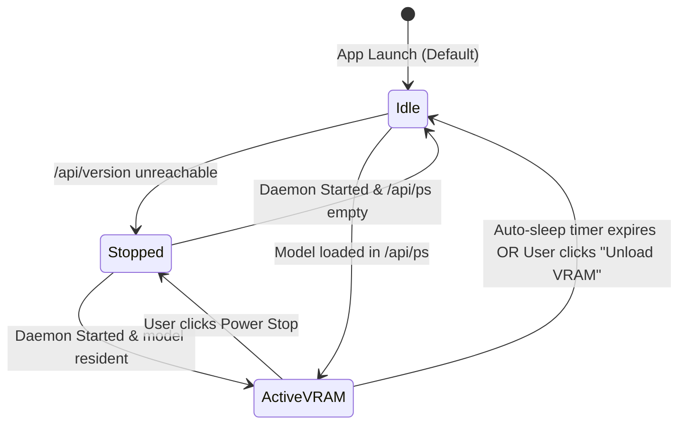
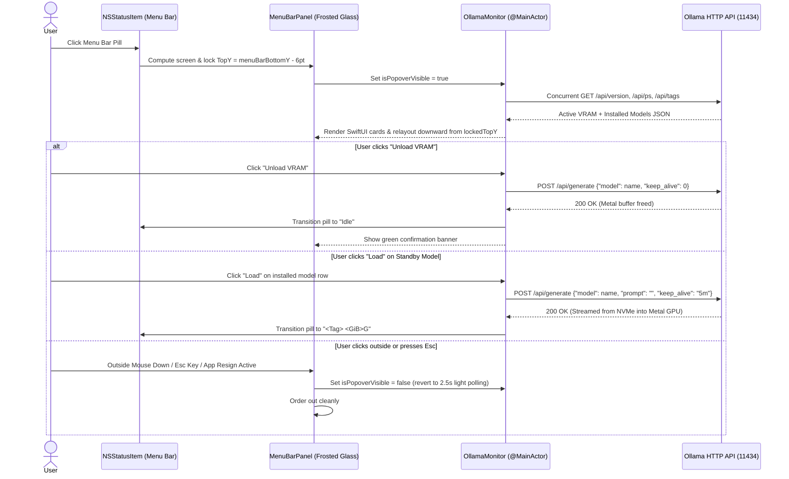

# 3. App Flow & User Journeys

> **Spec-Driven Development Doc #3 — The App Flow (Surface by Surface)**
> Maps the state machines, menu bar visual states, dropdown interaction flows, and CLI keyboard loop across `OllamaTop`.

---

## 🧭 1. Menu Bar Status Pill State Machine

`OllamaTop.app` runs as an `LSUIElement` accessory app (no Dock icon) and continuously reflects three mutually exclusive states in the macOS Menu Bar:

| State | Menu Bar Icon | Menu Bar Text | Meaning |
| :--- | :--- | :--- | :--- |
| **`Stopped`** | `bolt.horizontal.circle` (Template Monochrome) | `Off` | Ollama daemon is stopped or unreachable on `OLLAMA_HOST`. |
| **`Idle`** | `brain.head.profile` (Template Monochrome) | `Idle` | Daemon is online; `0.00 GB` GPU VRAM is consumed (auto-sleep active). |
| **`ActiveVRAM`** | `brain.head.profile` (Emerald Green Palette) | `<Tag> <GiB>G` (e.g., `R1 8.5G`, `Qwen32k 10.3G`) | Model weights + KV cache are resident in Metal Unified Memory. |

---

## 🪟 2. Menu Bar Dropdown Panel Lifecycle & User Journeys

---

## ⌨️ 3. Terminal TUI (`ollama-top`) Execution Flow

1. **Argument Parsing**:
   - `ollama-top --once`: Collects one snapshot of hardware specs, `vm_stat`, `/api/ps`, `/api/version`, `/api/tags`, and daemon log speed metrics, prints formatted ANSI table to `stdout`, and exits with code `0`.
   - `ollama-top [-i SECONDS]`: Enters raw cbreak TTY mode (`tty.setcbreak`), hides cursor (`\033[?25l`), and enters non-blocking `select.select` loop.
2. **Interactive Keybindings**:
   - **`[u]`**: Calls `unload_active_models()` (`keep_alive: 0` for all models in `/api/ps`), displays yellow confirmation banner for 4 seconds, and refreshes screen immediately.
   - **`[r]`**: Forces immediate poll refresh.
   - **`[q]` / `Ctrl-C`**: Restores original `termios` attributes and cursor visibility (`\033[?25h`) in a `finally:` block so the user's shell is never left broken.
