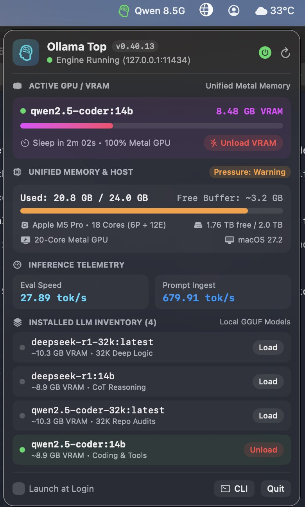

# 4. UI/UX Design Brief & Visual System

> **Spec-Driven Development Doc #4 — The Design Brief**
> Defines the native macOS Control Center visual language, semantic color tokens, typography rules, and geometric anatomy across `OllamaTop.app` and the `ollama-top` TUI.

---

## 🎨 1. Aesthetic Persona: "Apple Silicon Control Center"

`OllamaTop` is designed to feel indistinguishable from a native Apple macOS system menu bar module (such as Battery, Wi-Fi, or Control Center):
- **Vibrancy-First Translucent Canvas**: Uses AppKit `NSVisualEffectView` with `.popover` material and `.behindWindow` blending, automatically adapting between macOS Dark Mode and Light Mode.
- **Zero Layout Jitter**: Menu bar telemetry and numeric readouts strictly use monospaced digits (`monospacedDigitSystemFont` and `.design(.monospaced)`) so the menu bar item never shifts neighboring icons as numbers change.
- **Semantic State Signaling**: Color is reserved exclusively for actionable hardware state—green for healthy/idle, purple-pink gradient for active Metal GPU tensor residency, amber for memory warning, and crimson for memory critical / destructive VRAM eviction.

  

---

## 🌈 2. Semantic Color Tokens

| Semantic Token | SwiftUI Value | TUI ANSI Code | Usage Context |
| :--- | :--- | :--- | :--- |
| **Engine Active / Healthy** | `Color.green` / `NSColor.systemGreen` | `\033[32m` (`GREEN`) | Active menu bar brain icon, `● Engine Running` indicator, `Idle (0 GB VRAM)` card tint. |
| **Metal GPU VRAM Allocation** | `LinearGradient([.purple, .pink])` | `\033[35m` (`MAGENTA`) | Active GGUF model VRAM progress bar and resident card highlight (`0.08` opacity fill). |
| **Unified Memory Normal** | `Color.teal` | `\033[32m` (`GREEN`) | Unified RAM progress bar when `kern.memorystatus_vm_pressure_level == 1`. |
| **Memory Pressure Warning** | `Color.orange` | `\033[33m` (`YELLOW`) | RAM bar & pressure pill when kernel memory pressure reaches `WARN` (`level == 2`). |
| **Memory Pressure Critical / Evict** | `Color.red` | `\033[31m` (`RED`) | Critical RAM pressure (`level >= 4`), `Daemon Stopped` dot, and `Unload VRAM` capsule button. |
| **Eval & Prompt Telemetry** | `Color.cyan` / `Color.blue` | `\033[36m` / `\033[34m` | Token generation speed (`tok/s`) and prompt ingestion speed tiles. |

---

## 📐 3. Geometry, Spacing & Typography

### Menu Bar Status Item (`NSStatusBarButton`)
- **Icon**: SF Symbol `brain.head.profile` (`13.5pt`, `.medium` idle / `.semibold` active) or `bolt.horizontal.circle` when stopped.
- **Font**: `NSFont.monospacedDigitSystemFont(ofSize: 12, weight: .medium)`.
- **Label Length Cap**: Maximum `13` characters (e.g., `Qwen32k 10.3G`) to respect MacBook Notch horizontal menu bar space.

### Dropdown Panel (`MenuBarPanel`)
- **Fixed Width**: `380pt` (`padding: 12pt`, `spacing: 9pt` between cards).
- **Corner Radius**: `14.0pt` outer window mask with `0.8pt` translucent `separatorColor` border; `10pt` inner card radius; `Capsule` progress bars (`height: 7pt`).
- **Top Gap**: Strictly `6.0pt` below the clicked screen's menu bar bottom edge (`lockedTopY`).
- **Scroll Cap**: When more than 5 GGUF models are installed, the inventory list caps at `maxHeight: 215pt` inside a vertical `ScrollView` so the panel fits comfortably on 1080p displays.
