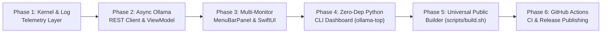

# 6. Implementation Plan & Public Builder Pipeline

> **Spec-Driven Development Doc #6 — Implementation Plan (Build Order & Release Protocol)**
> Defines the modular build order, Universal Binary compilation architecture, CI/CD release pipeline, and verification protocol for contributors and automated agents.

---

## 🏗️ 1. Layered Build Order (6 Sequential Phases)



1. **Phase 1 — Kernel & Hardware Telemetry (`SystemTelemetry`)**: Implement zero-subprocess Mach `host_statistics64`, `sysctlbyname` wrappers, IOKit GPU core discovery, filesystem capacity checks, and 64 KB log tail parsers.
2. **Phase 2 — Reactive State & Mutations (`OllamaMonitor`)**: Implement `@MainActor` `ObservableObject` state management with tiered `2.5s` / `1.0s` timers, `keep_alive: 0` VRAM eviction, warm model preloading, and multi-installation daemon start/stop controls.
3. **Phase 3 — Multi-Monitor AppKit Shell & SwiftUI Cards (`MenuBarPanel` + `PopoverDashboardView`)**: Bind `NSStatusItem` live pill states and top-edge-locked `NSVisualEffectView` dropdown panel (`6pt` below menu bar across Notch & external screens).
4. **Phase 4 — Standalone Terminal TUI (`cli/ollama-top`)**: Maintain feature parity in a single zero-dependency Python 3 executable supporting interactive hotkeys (`[u]`, `[r]`, `[q]`) and `--once` snapshot output.
5. **Phase 5 — Local & Universal Public Builder (`scripts/build.sh`, `scripts/install.sh`, `Makefile`)**: Generate Retina `AppIcon.icns`, cross-compile `arm64` + `x86_64` slices (`macOS 13.0+`), merge with `lipo`, ad-hoc sign, and archive with SHA-256 checksums.
6. **Phase 6 — Automated GitHub Actions Public Builder (`.github/workflows/`)**: Run continuous verification on `macos-latest` (`ci.yml`) and publish signed Universal release bundles on `v*.*.*` tags (`release.yml`).

---

## 📦 2. Public Builder Commands (`Makefile` & Scripts)

```bash
# 1. Build native architecture app bundle + CLI into ./dist/
make build

# 2. Cross-compile Universal Binary (arm64 + x86_64, macOS 13.0+)
make universal

# 3. Produce full public release artifacts (.zip, .tar.gz, SHA256SUMS.txt)
make package

# 4. Install into ~/Applications/OllamaTop.app and ~/.local/bin/ollama-top (Zero sudo)
make install

# 5. Run automated verification suite
make test
```

---

## ✅ 3. Pre-Release Verification Checklist

Every pull request and release tag must pass all five automated checks before publication:

1. **Universal Fat Binary Check**: `lipo -info dist/OllamaTop.app/Contents/MacOS/OllamaTop` outputs `Architectures in the fat file ... are: x86_64 arm64`.
2. **Code Signature Integrity**: `codesign --verify --deep --strict dist/OllamaTop.app` exits `0`.
3. **CLI Bytecode & Snapshot Smoke Test**: `python3 -m py_compile cli/ollama-top && ./dist/ollama-top --once` exits `0` whether Ollama is running or stopped.
4. **Checksum Verification**: `(cd dist && shasum -a 256 -c SHA256SUMS.txt)` exits `0`.
5. **Zero Hardcoded Path Audit**: `grep -rn "/Users/" menubar/ cli/ scripts/` returns empty.
